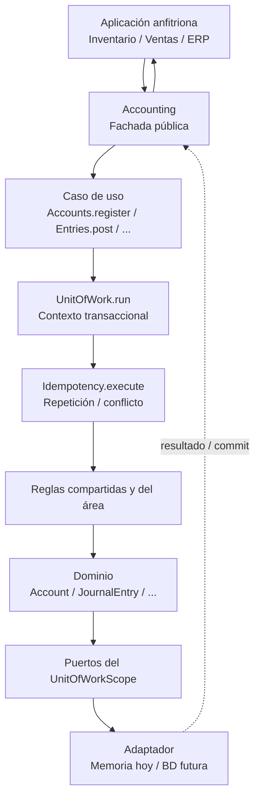

# Contability Core

Motor contable reutilizable escrito en **TypeScript**, pensado para integrarse en aplicaciones de inventario, ventas, ERP u otros sistemas sin acoplar el núcleo a una interfaz gráfica, un ORM o una base de datos concreta.

> **Estado:** proyecto en desarrollo (`0.1.0`, paquete publicable en un workspace de pnpm, licencia MIT). Ya existen modelos de dominio, 17 operaciones de aplicación, puertos y un adaptador en memoria para desarrollo y pruebas. No hay persistencia durable de producción incluida. Consulta [docs/STATUS.md](docs/STATUS.md) para el alcance y pendientes actualizados.

## Paquetes

El repositorio es un workspace de pnpm: **un paquete publicable por artefacto**. Un anfitrión instala el motor y, por separado, los adaptadores que realmente usa; el core no arrastra drivers ni frameworks.

| Paquete | Contenido |
| --- | --- |
| `packages/core` | El motor: dominio, aplicación, puertos y el adaptador en memoria. Sin ORM, sin HTTP, sin acceso a disco. |

```bash
pnpm add @pazos-dev/contability-core
```

Los adaptadores durables —Prisma, PostgreSQL u otro— viven en paquetes propios bajo `packages/` y declaran el driver como `peerDependency`, para que el anfitrión decida la versión y no convivan dos clientes en el mismo proceso.

## Arquitectura

El proyecto sigue una separación inspirada en **Clean Architecture**:

| Componente | Responsabilidad |
| --- | --- |
| `packages/core/src/core/domain/` | Entidades y reglas contables internas: `Ledger`, `Account`, `Journal`, `AccountingPeriod`, `JournalEntry`, `Money` y sus valores asociados. |
| `packages/core/src/core/application/facade/accounting.ts` | Punto de entrada `Accounting`: recibe una operación y delega en el caso de uso correspondiente. |
| `packages/core/src/core/application/use-cases/` | Orquesta casos de uso organizados por área (`ledgers`, `accounts`, `journals`, `periods`, `entries`). |
| `packages/core/src/core/application/use-cases/shared/` | Reglas reutilizables e idempotencia; no forma parte de la API pública. |
| `packages/core/src/core/application/dto.ts` | Tipos de entrada y salida serializables, independientes de entidades u ORM. |
| `packages/core/src/core/application/ports.ts` | Interfaces de repositorios y unidad de trabajo, implementadas por los adaptadores. |
| `packages/core/src/core/application/errors.ts` | Errores de aplicación con códigos estables; los errores del dominio se propagan. |
| `packages/core/src/adapters/memory/` | Implementación volátil de repositorios y unidad de trabajo para pruebas/desarrollo. |



El diagrama representa el flujo lógico, no una secuencia literal de llamadas para todas las operaciones: las comprobaciones de reglas pueden consultar repositorios antes de crear o modificar una entidad, y el registro de idempotencia ocurre después de guardar el cambio, **dentro de la misma unidad de trabajo**.

## Flujo de una operación: registrar una cuenta contable

Antes de registrar cuentas hay que registrar un **libro contable** (`Ledger`) al que pertenece el plan de cuentas.

### 1. La aplicación anfitriona construye el motor

```ts
import { Accounting, createInMemoryAccounting } from '@pazos-dev/contability-core';

const adapter = createInMemoryAccounting();
const accounting = new Accounting({ unitOfWork: adapter.unitOfWork });
```

Este ejemplo presupone que el paquete ya está compilado y disponible para importación. `createInMemoryAccounting` sirve para desarrollo y pruebas; sustituye el adaptador para usar una base de datos real.

### 2. Registra un libro y una cuenta

```ts
await accounting.registerLedger({
  ledgerId: 'empresa-1',
  name: 'Contabilidad principal',
  chartOfAccountsId: 'plan-1',
  currency: { code: 'UYU', scale: 2 },
  idempotencyKey: 'crear-libro-empresa-1',
});
```

La moneda funcional se declara en el alta y no cambia después: el libro lleva una sola unidad de cuenta y
contabilizar un asiento en otra moneda se rechaza con `LEDGER_CURRENCY_MISMATCH`. La escala viaja con el
código porque forma parte de la identidad monetaria y se persiste con el importe, no se deduce del código.

```ts
  ledgerId: 'empresa-1',
  accountId: 'caja-001',
  code: '1101',
  name: 'Caja',
  type: 'ASSET',
  postingAllowed: true,
  idempotencyKey: 'crear-caja-001',
});
```

`result` es un **DTO**, no una instancia de `Account`.

### 3. Qué sucede por dentro

1. **Fachada:** `Accounting.registerAccount(input)` delega en `Accounts.register(deps, input)`. La fachada no valida ni persiste.
2. **Huella:** `fingerprintOf` representa los campos relevantes de la petición, sin la clave de idempotencia.
3. **Transacción:** `deps.unitOfWork.run(async scope => ...)` proporciona los repositorios que participan en la misma operación.
4. **Idempotencia:** `Idempotency.execute(key, fingerprint, work)` devuelve el resultado previamente registrado si corresponde, o rechaza la reutilización de la clave para otra petición.
5. **Reglas entre entidades:** se verifica que el libro exista y esté activo, que el ID y código de cuenta estén disponibles y que una eventual cuenta padre sea admisible.
6. **Dominio:** `Account.create(...)` construye la cuenta y aplica sus invariantes locales.
7. **Persistencia:** `scope.accounts.save(account)` guarda la entidad a través del puerto, sin conocer la tecnología de almacenamiento.
8. **Registro y salida:** se registra el resultado de idempotencia (si había clave), se completa la unidad de trabajo y el DTO vuelve a la aplicación a través de la fachada.

Una forma simplificada de visualizar las llamadas:

```ts
// Fachada (idea; no es una copia completa del archivo)
registerAccount(input: RegisterAccountInput) {
  return Accounts.register(this.#deps, input);
}

// Caso de uso (pseudocódigo resumido)
return deps.unitOfWork.run(async (scope) => {
  const idempotency = Idempotency.of(scope, 'registerAccount', input.ledgerId);
  return idempotency.execute(input.idempotencyKey, fingerprint, async () => {
    const chartId = await requireChartOfAccountsId(scope, input.ledgerId);
    // Comprobar ID, código y cuenta padre...
    const account = Account.create({ /* datos validados */ });
    await scope.accounts.save(account);
    return { /* DTO de resultado */ };
  });
});
```

### Reglas de responsabilidad

- **Fachada:** punto de acceso público, composición y delegación.
- **Caso de uso:** ordena las validaciones, consulta puertos, ejecuta operaciones del dominio y coordina la transacción.
- **Dominio:** protege las invariantes de cada entidad; no ejecuta consultas SQL.
- **Puerto:** expresa **qué** necesita la aplicación de la persistencia, no **cómo** implementarlo.
- **Adaptador:** resuelve el **cómo** para una tecnología concreta.
- **DTO:** intercambia datos serializables; los importes se representan como `MoneyJSON`, sin enviar objetos de dominio por la frontera.

## Flujo de una venta

Para una venta cobrada en efectivo, el asiento conceptual podría ser:

| Cuenta | Debe | Haber |
| --- | ---: | ---: |
| Caja | 1.000 | — |
| Ventas | — | 1.000 |
| **Total** | **1.000** | **1.000** |

Este asiento presupone que las cuentas, el diario y el período ya existen. La contabilización se realiza en **dos operaciones distintas**:

1. `accounting.createEntryDraft(...)`: guarda un **borrador** con fecha, diario, período y líneas. Un borrador puede estar desequilibrado y no exige que el período esté abierto ni el diario activo.
2. `accounting.postEntry({ ledgerId, entryId, idempotencyKey })`: vuelve a verificar libro, diario, período, fecha y cuentas; el dominio comprueba que el asiento puede contabilizarse y que el **Debe = Haber**. Después guarda el asiento contabilizado dentro de una unidad de trabajo.

El asiento contabilizado no se modifica en el sitio: las correcciones se representan mediante un **nuevo asiento de reversión** con `reversePostedEntry(...)`, sujeto a sus propias validaciones.

## Operaciones disponibles en `Accounting`

| Área | Métodos |
| --- | --- |
| Libros | `registerLedger`, `setLedgerStatus` |
| Cuentas | `registerAccount`, `setAccountStatus` |
| Diarios | `registerJournal`, `setJournalStatus` |
| Períodos | `registerPeriod`, `closePeriod` |
| Asientos | `createEntryDraft`, `addEntryLine`, `removeEntryLine`, `changeEntryHeader`, `postEntry`, `reversePostedEntry` |

Estas operaciones internas se agrupan en clases de área con **métodos estáticos sin estado global**; las dependencias pasan por parámetro. La fachada sí es una instancia que conserva `ApplicationDeps` en un campo privado. Así, diferentes instancias de `Accounting` pueden apuntar a distintos adaptadores sin compartir una configuración estática mutable.

## Idempotencia y transacciones

- La clave de idempotencia se interpreta por **libro + operación + clave**, no globalmente.
- La misma clave y el mismo contenido permiten recuperar el resultado guardado; reutilizar la clave con otro contenido produce `IDEMPOTENCY_CONFLICT`.
- `fingerprintOf` genera una **representación JSON determinista**; no es un hash criptográfico.
- La escritura contable y el registro de idempotencia deben confirmarse o revertirse **atómicamente**. Un adaptador real necesita restricciones de unicidad, transacciones y aislamiento adecuados para peticiones concurrentes.
- **Limitación importante:** el adaptador en memoria no ofrece aislamiento entre operaciones concurrentes ni durabilidad. Es un recurso de desarrollo, no una base de datos de producción.

## Desarrollo local

Requisitos declarados por el proyecto: **Node.js >= 24** y **pnpm >= 10**. El paquete declara `pnpm@11.25.0` y TypeScript `5.9.3`.

```bash
pnpm install --frozen-lockfile
pnpm check:project
pnpm typecheck
pnpm build
pnpm test

# Validación conjunta
pnpm check
```

| Comando | Propósito |
| --- | --- |
| `pnpm check:project` | Valida la estructura y documentación del proyecto. |
| `pnpm typecheck` | Comprueba los tipos TypeScript sin emitir archivos. |
| `pnpm build` | Compila el paquete a `dist/`. |
| `pnpm test` | Ejecuta las pruebas del proyecto. |
| `pnpm check` | Ejecuta las verificaciones anteriores en secuencia. |
| `pnpm sync:iso4217` | Sincroniza el catálogo de monedas ISO 4217. |

## Documentación adicional

- [Estado de implementación](docs/STATUS.md)
- [Arquitectura](docs/ARCHITECTURE.md)
- [Reglas de dominio](docs/DOMAIN.md)
- [Integración con aplicaciones anfitrionas](docs/INTEGRATION.md)
- [Especificaciones de comportamiento](docs/specs/)
- [Tareas y roadmap](docs/ROADMAP.md)
- [Instrucciones para agentes](AGENTS.md)

**Principio central:** el motor toma decisiones contables mediante sus casos de uso y entidades; la aplicación anfitriona decide cuándo invocarlo y el adaptador decide dónde guardar los datos.
